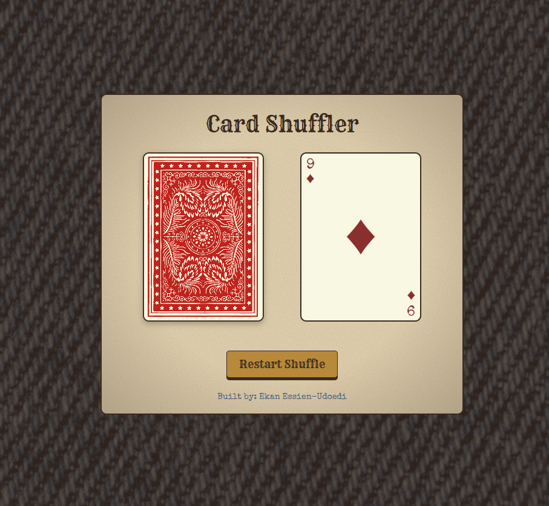

# Card Shuffler

A Wild West themed card shuffler built with HTML, CSS, and vanilla JavaScript. It builds a standard 52-card deck, shuffles it, and lets you draw cards one at a time with no repeats.

**Live demo:** In progress

## Features

- Standard 52-card deck, shuffled randomly
- Click the draw pile to draw a card
- Discard pile shows the card you drew
- Restart button to shuffle a fresh deck
- Responsive layout for phones and desktop

## Built with

- HTML5
- CSS3 (custom properties, flexbox, media queries)
- JavaScript (ES6)
- Google Fonts: Rye and Special Elite

## Run it locally

1. Clone the repo: `git clone <your-repo-url>`
2. Open the folder in VS Code
3. Open `index.html` in your browser, or use the Live Server extension

## What I learned

- Building a 52-card deck with nested loops
- Drawing a random card with `splice` so no card repeats
- Handling game state: first draw, last card, and restart
- Updating the page with event listeners and `classList`
- Layering gradients, SVG textures, and blend modes for an aged paper look
- Using CSS custom properties to keep the color palette in one place
- Styling hover, focus, and disabled states, and making the layout responsive
- Using semantic HTML and keyboard-friendly buttons
- Debugging with DevTools and using Git and GitHub

## Credits

- Card back: [Colorful Poker Card Back](https://opengameart.org/content/colorful-poker-card-back) by jeffshee, via OpenGameArt
- Background: [Blue denim fabric with twill weave](https://unsplash.com/photos/blue-denim-fabric-with-twill-weave-VgEaUEyKUpk) by dylanhendricks, via Unsplash

## Author

Ekan Essien-Udoedi
